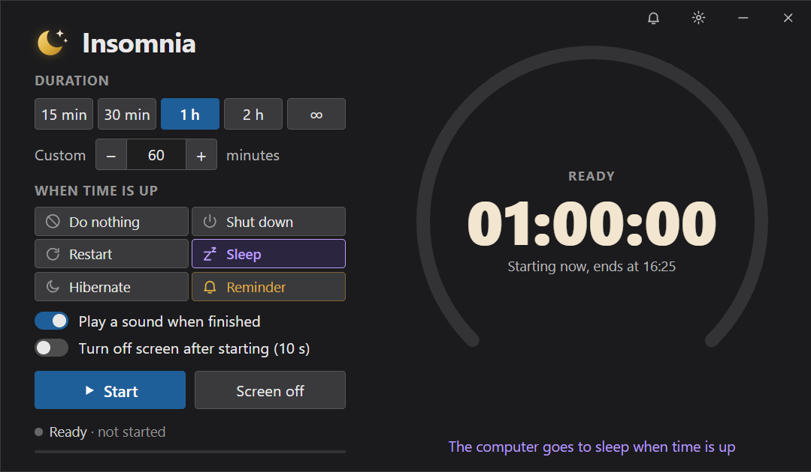
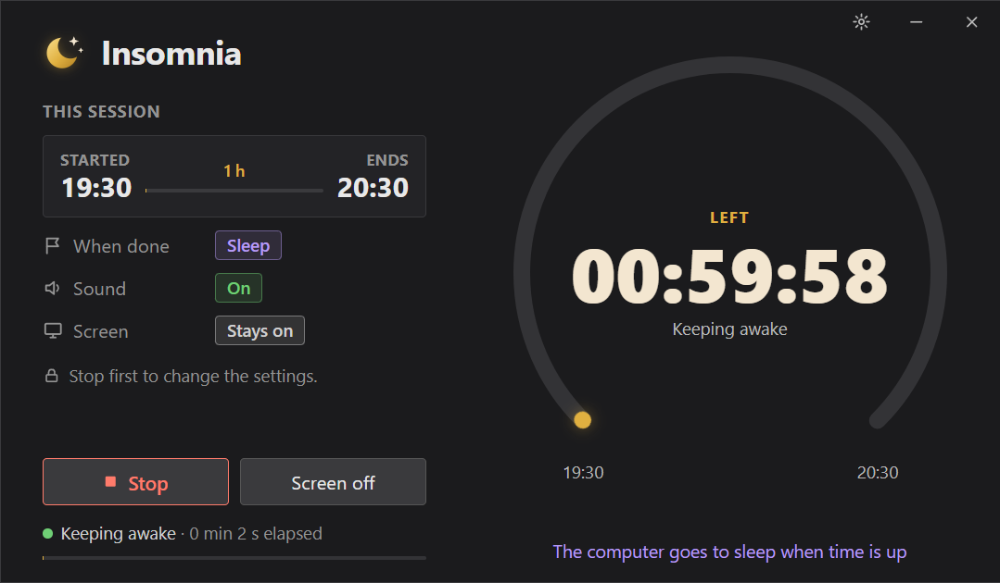
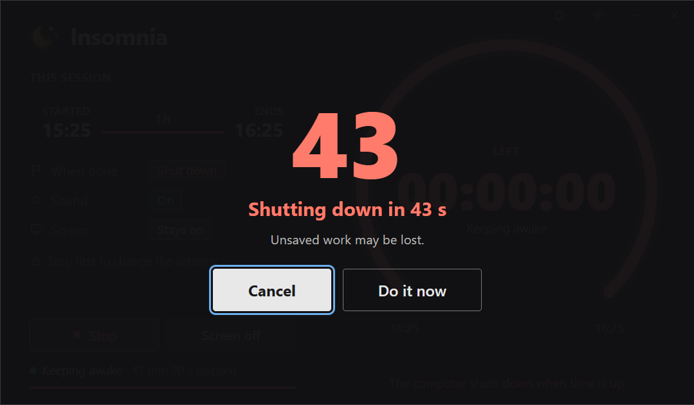
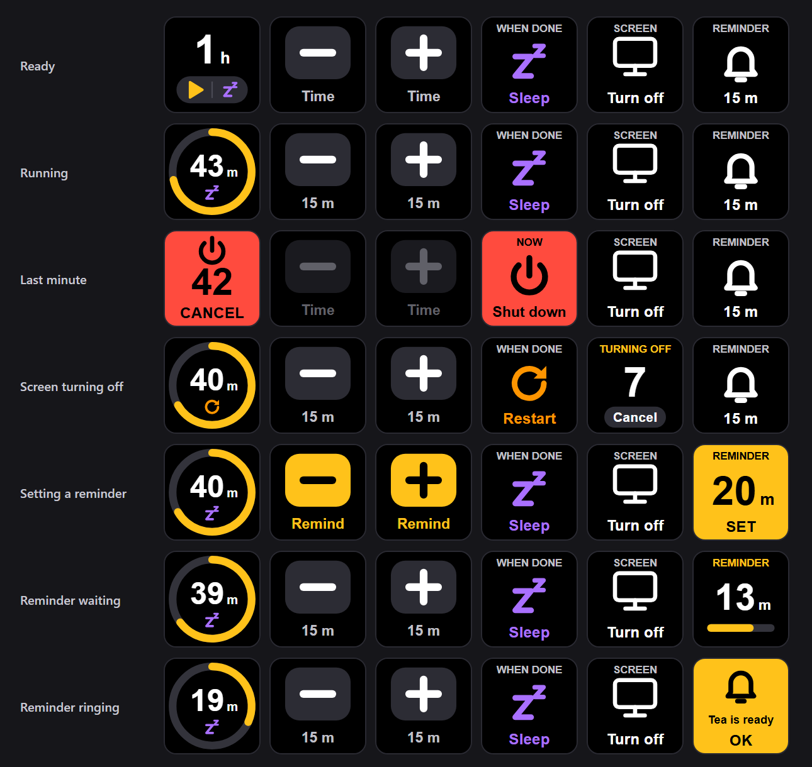

# Insomnia

**English** · [Türkçe](README.tr.md)

A small Windows program that keeps your computer awake for as long as you choose.
When the time is up it can shut the computer down, restart it, put it to sleep or hibernate it.

**Made for the Ulanzi D200:** the program can be controlled from an Ulanzi D200 key deck. The plugin lives in
this repository (the `ulanzi` folder) and ships inside the installer; from the keys you start and stop a session,
add time and choose what happens at the end. Without the device the program works fully on its own.

Version: 1.4.1 · **Final release**



| Running | Last minute |
| --- | --- |
|  |  |

On the Ulanzi D200:



## What it does

- **Duration:** 15 min, 30 min, 1 h, 2 h, no limit (∞) or a custom duration from 1 to 1440 minutes.
- **When time is up:** do nothing, shut down, restart, sleep, hibernate.
- **Sound:** two short beeps when the time is up.
- **Screen off:** from a button or when the session starts; either way with a 10 second countdown you can cancel.
- **Tray icon (next to the clock):** a moon. Grey when ready; gold while running, with a ring that shows the time left; in the last minutes it takes the colour of the end action.
  Its menu has quick start, stop, start with Windows, language and exit.
- **Languages:** Turkish, English, German, French, Spanish.

## Behaviour worth knowing

- Before shutting down, restarting, sleeping or hibernating there is a **60 second warning**; the window comes to
  the front and the screen turns on if it was off. Press "Cancel" and nothing happens.
- Shut down and restart force open programs to close (`shutdown /f`); unsaved work is lost.
- **The end action is not remembered.** The program always starts with "Do nothing".
- **Quick start from the tray** only keeps the computer awake; it does nothing at the end.
- If you put the computer to sleep by hand during a session, the session stops **without running the end action**.
- Closing the window (×) does not exit the program, it hides it in the tray. Exit is in the tray menu.
- **Settings (gear):** where the program shows up (tray + taskbar, tray only, taskbar only), language and start with Windows. With "taskbar only" there is no tray icon; × minimises the window during a session and exits the program when idle.
- The program does not block Windows from shutting down or signing out.
- Settings are stored in `%APPDATA%\Insomnia\settings.json`.

## Installing

Run `Insomnia-Setup-<version>.exe` (the installer). It needs no administrator rights;
the program is installed under `%LOCALAPPDATA%\Programs\Insomnia`. The installer asks:

- **Also install the Ulanzi D200 plugin** (shown only if Ulanzi Studio is on the computer)
- **Start with Windows**
- **Create a desktop shortcut**

To update, run the newer installer: it closes the running Insomnia itself (and asks first if a session is
running). Uninstall from Windows "Apps"; the settings (`%APPDATA%\Insomnia`) are kept.

If you prefer no installation, `Insomnia.exe` also runs on its own (portable).

## Running from source

```
pip install -r requirements.txt
python main.py           # with the window
python main.py --tray    # tray icon only
```

Requires Windows 10/11 and Microsoft Edge WebView2 (included in Windows 11).

## Controlling it from outside (the control door)

While the program is running, other programs can control it. The Ulanzi D200 plugin uses this
(see the `ulanzi` folder; its README explains the setup).

From the command line:

```
Insomnia.exe --baslat 60                    # 60 minute session (0 = no limit); opens in the tray if not running
Insomnia.exe --baslat 60 --islem shutdown   # shut down at the end (restart, sleep, hibernate)
Insomnia.exe --durdur                       # stop
Insomnia.exe --ekran-kapat                  # turn the screen off
Insomnia.exe --cik                          # exit the program
```

From a program: `%LOCALAPPDATA%\Insomnia\kumanda.json` holds the port (`port`) and the key (`token`).
The server listens on 127.0.0.1 only; every request must carry the key in the `X-Insomnia-Anahtar`
header. Requests coming from a browser (those with an Origin header) are refused.

- `GET /durum` returns the session state.
- `POST /komut` with body `{"komut": "..."}`: `start` (`minutes`, `infinite`, `action`), `stop`,
  `cancel` (cancel during the warning), `act_now` (do it without waiting during the warning), `adjust`
  (`seconds`; adds or removes time from the running session), `set_action` (`action`; changes what the
  running session does at the end), `screen_off`, `cancel_screen_off`, `show`.

## Building

```
python build.py
```

Produces `dist\Insomnia.exe` (single file, portable) and, if Inno Setup 6 is installed,
`dist\Insomnia-Setup-<version>.exe` (the installer, from `kurulum\insomnia.iss`). The version number is
`__version__` in `insomnia/__init__.py`.

## Testing

```
python -m unittest discover -s tests
```

To make sure the computer does not really shut down while testing:

```
set INSOMNIA_DRY_RUN=1
```

With this variable set, shut down, restart, sleep, hibernate and screen off are not carried out.

## Files

| File | Job |
| --- | --- |
| `main.py` | Launcher; single instance check |
| `insomnia/app.py` | Ties window, tray and timer together; the actions the interface calls |
| `insomnia/engine.py` | Session timer (single thread) |
| `insomnia/remote.py` | Control door and command line client |
| `kurulum/insomnia.iss` | Installer recipe (Inno Setup) |
| `ulanzi/` | Ulanzi D200 plugin (Node.js) |
| `insomnia/power.py` | Keep awake, screen, shut down actions |
| `insomnia/settings.py` | Settings file |
| `insomnia/startup.py` | Start with Windows entry |
| `insomnia/single_instance.py` | Shows the first copy's window when a second one is opened |
| `insomnia/tray.py`, `insomnia/icons.py` | Tray icon, its menu and the moon drawing |
| `insomnia/i18n.py` | Texts in five languages |
| `insomnia/ui/index.html` | Interface (HTML, CSS, JavaScript in one file) |
| `tests/` | Timer, settings and translation tests |
| `build.py` | Builds the exe and the installer |

The code comments and command names are in Turkish.

## License

[MIT](LICENSE). The Ulanzi plugin bundles `plugin-common-node` (Apache-2.0) and `ws` (MIT) from Ulanzi's SDK;
their licence files are kept next to them.
