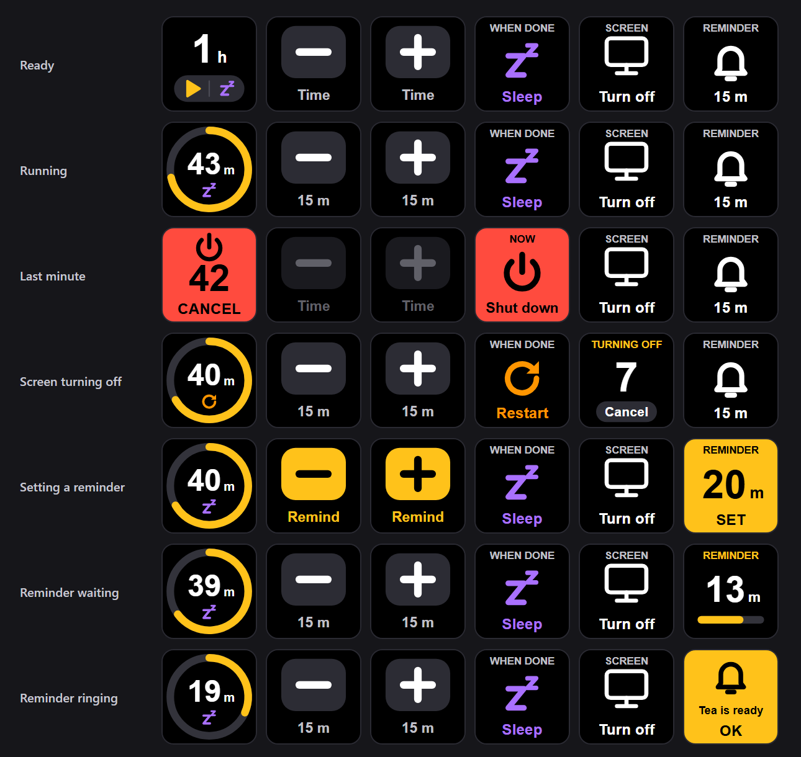

# Insomnia: Ulanzi D200 plugin

**English** · [Türkçe](README.tr.md)

An Ulanzi Studio plugin for controlling Insomnia from the Ulanzi D200 keys. Requires Insomnia 1.2.0 or
later (the control door arrived in that version).

Version: 1.2.0



## Keys

| Key | When idle | While running | During the 60 s warning |
| --- | --- | --- | --- |
| Start / Stop | Shows the chosen duration, press to start | Shows the time left, press to stop | Seconds left; press to cancel |
| Time − / Time + | Chooses the duration to start with (15 min … 8 h, no limit; first choice 15 min). The key is dimmed in the direction it cannot go | Removes / adds 15 min | No effect |
| When done | Chooses what happens at the end (nothing, shut down, restart, sleep, hibernate) | Changes the end action of the running session | "Now": does it without waiting |
| Screen off | Turns the screen off after 10 s; press again to cancel | same | same |

The plugin only offers the end actions the installed Insomnia can do (sleep, for example, arrived with Insomnia 1.3.0).
If the program starts but the control door never appears (Insomnia older than 1.2.0), the keys say "Update".

### Reminder key (Insomnia 1.5.0 or later)

Time − / Time + normally set the keep-awake duration. Press the Reminder key once and all three keys turn
gold: for a few seconds Time − / Time + set the reminder's time instead.

| State | On the key | 1st press | Time − / Time + | 2nd press |
| --- | --- | --- | --- | --- |
| No reminder | A bell and the starting time (Insomnia: Settings → Reminder → Default time) | Opens the time setting | Change it between 1 min and 4 h | Sets the reminder |
| Waiting | Time left and a progress bar; "+1" if there are more | Asks "Cancel?" | Shorten / extend the time left by 5 min | Deletes it |
| Ringing | A blinking gold key with the note and "OK" | Dismisses it | — | — |

If no key is pressed for 6 seconds while the time setting is open, it closes without doing anything. A
reminder set from the key has no note; sound and on-screen choices are the ones last used in the window.
With Insomnia older than 1.5.0 this key says "Update"; the other keys keep working.

While Insomnia is closed the keys say "Closed". Pressing a key opens the program in the tray; if the key
was Start or Screen, the request is carried out once the program is up.

"Now" does not work in the first 2 seconds of the warning (against accidental presses).

The key texts are in Turkish or English, following Insomnia's language; with German, French or Spanish they are in English.

## Installing

The easy way is Insomnia's installer: leave "Also install the Ulanzi D200 plugin" ticked. To install by hand:

copy the `com.ulanzi.ulanzistudio.insomnia.ulanziPlugin` folder here and restart Ulanzi Studio:

```
%APPDATA%\Ulanzi\UlanziDeck\Plugins
```

Then in Ulanzi Studio drag the keys from the "Insomnia" group in the list on the right onto the device.

## How it works

`plugin/app.js` reads the state from Insomnia's control door twice a second (using the port and key in
`%LOCALAPPDATA%\Insomnia\kumanda.json`) and redraws the keys that changed. The drawings are produced in
`plugin/cizim.js` as 196×196 pixel SVG. The chosen duration and end action are stored in
`%LOCALAPPDATA%\Insomnia\ulanzi.json`.

`plugin-common-node` and `node_modules/ws` come from Ulanzi's official SDK (Apache-2.0).
