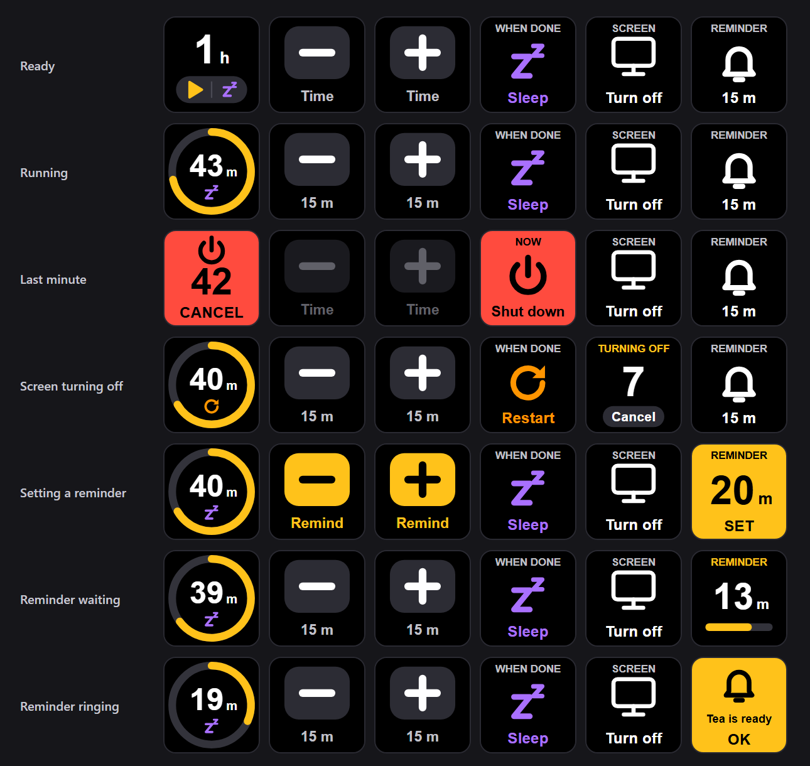

# Insomnia: Ulanzi D200 eklentisi

[English](README.md) · **Türkçe**

Insomnia'yı Ulanzi D200 tuşlarından yönetmek için Ulanzi Studio eklentisi. Insomnia 1.2.0 ve
sonrası gerekir (kumanda kapısı o sürümde geldi).

Sürüm: 1.1.1



Tuş yazıları Insomnia'nın diline göre Türkçe ya da İngilizce çıkar (görüntü İngilizce halinden).

## Tuşlar

| Tuş | Boştayken | Çalışırken | 60 sn'lik uyarıda |
| --- | --- | --- | --- |
| Başlat / Durdur | Seçili süreyi gösterir, basınca başlatır | Kalan süreyi gösterir, basınca durdurur | Kalan saniye; basınca vazgeçer |
| Süre − / Süre + | Başlatılacak süreyi seçer (15 dk … 8 sa, süresiz; ilk seçim 15 dk). Gidemeyeceği yönde tuş soluk durur | 15 dk çıkarır / ekler | Etkisiz |
| Bitince | Bitişte ne olacağını seçer (yok, kapat, yeniden başlat, uyut, hazırda beklet) | Çalışan oturumun bitişini değiştirir | "Şimdi yap": beklemeden uygular |
| Ekranı Kapat | Ekranı 10 sn sonra kapatır; tekrar basınca iptal | aynı | aynı |

Eklenti yalnız kurulu Insomnia'nın yapabildiği bitiş işlemlerini sunar (örneğin uyku, Insomnia 1.3.0 ile geldi).
Program açıldığı halde kumanda kapısı gelmezse (Insomnia 1.2.0'dan eskiyse) tuşlarda "Güncelle" yazar.

Insomnia kapalıyken tuşlar "Kapalı" yazar. Bir tuşa basınca program tepside açılır; basılan
tuş Başlat ya da Ekran ise istek program açılınca yerine getirilir.

Uyarı başladıktan sonraki ilk 2 saniyede "Şimdi yap" çalışmaz (yanlışlıkla basmaya karşı).

## Kurulum

En kolayı Insomnia'nın kurulum paketi: "Ulanzi D200 eklentisini de kur" kutusunu işaretli bırak. Elle kurmak için:

`com.ulanzi.ulanzistudio.insomnia.ulanziPlugin` klasörünü şuraya kopyala, Ulanzi Studio'yu
yeniden başlat:

```
%APPDATA%\Ulanzi\UlanziDeck\Plugins
```

Sonra Ulanzi Studio'da sağdaki listede "Insomnia" başlığından tuşları cihaza sürükle. Listedeki adlar İngilizcedir
(Start / Stop, Time −, Time +, When done, Screen off); tuşların üstündeki yazılar Insomnia'nın diline göre çıkar.

## Nasıl çalışır

`plugin/app.js` yarım saniyede bir Insomnia'nın kumanda kapısından durumu okur
(`%LOCALAPPDATA%\Insomnia\kumanda.json` içindeki kapı numarası ve anahtarla) ve değişen
tuşları yeniden çizer. Çizimler `plugin/cizim.js` içinde, 196×196 piksellik SVG olarak üretilir.
Seçili süre ve bitiş işlemi `%LOCALAPPDATA%\Insomnia\ulanzi.json` dosyasında saklanır.

`plugin-common-node` ve `node_modules/ws` Ulanzi'nin resmi geliştirme kitinden gelir
(Apache-2.0).
